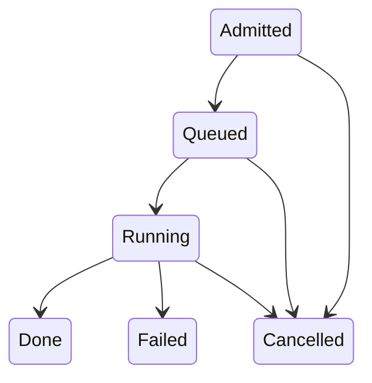

# Lifecycles and states

[Documentation index](../README.md#documentation)

The [lifecycle ontology](../ekgf-lifecycle.ttl) defines lifecycles,
phases, states, permitted transitions and their assignments. The
[lifecycle registry](../dataset/well-known-lifecycles.ttl) contains
reusable lifecycles; [class bindings](../dataset/lifecycle-bindings.ttl)
supply the default assignments.

## Available lifecycles

A lifecycle has a name, states and permitted transitions, optionally
grouped into phases. Its states and transitions form a directed graph.

A lifecycle does not require its own RDF named graph. Multiple lifecycles
can share the default graph or a named graph. The
`ekg-lifecycle:inLifecycle` property identifies which lifecycle a phase,
state or transition belongs to, independently of RDF graph placement.

The registry uses a separate namespace for each lifecycle,
`https://ekgf.org/lifecycle/<slug>#`, to distinguish shared state names
such as Draft and Deprecated. This is an IRI naming convention, not a
requirement to store each lifecycle in a separate graph. Custom lifecycles
can use another IRI naming convention.

- `continuous-improvement`: plan, build, run and evolve, in nine
  states from identified to decommissioned
- `achievement`: draft, active, achieved, deprecated
- `software-delivery`: development, test, user acceptance test,
  production
- `publication`: from working draft to published, and on to
  superseded or withdrawn
- `execution`: admitted, queued, running, then done, failed or
  cancelled

## Selecting a lifecycle

A thing can follow several lifecycles. Its effective set is decided in
this order.

1. If there are explicit `ekg-lifecycle:followsLifecycle` assignments,
   use their complete set.
2. Otherwise, use the union of lifecycles assigned through
   `ekg-lifecycle:appliesTo` to the thing's classes, including superclasses.

Explicit assignments replace the entire default set; they do not add
to it. To retain a default alongside an additional lifecycle, name both
with `followsLifecycle`.

The [class bindings](../dataset/lifecycle-bindings.ttl) are defaults.
They are policy, so an organization that wants its stories, say, to
follow a lifecycle of its own replaces the binding in its own data.

## Recording a state

```turtle
@prefix ex: <https://example.org/> .
@prefix ekg-lifecycle: <https://ekgf.org/ontology/lifecycle#> .
@prefix continuous-improvement: <https://ekgf.org/lifecycle/continuous-improvement#> .

ex:my-story
    ekg-lifecycle:followsLifecycle
        <https://ekgf.org/lifecycle/continuous-improvement> ;
    ekg-lifecycle:inState
        <urn:uuid:42e37aef-00e5-4808-b9df-312c8f7c34d6> .

<urn:uuid:42e37aef-00e5-4808-b9df-312c8f7c34d6>
    a ekg-lifecycle:StateTransition ;
    ekg-lifecycle:currentState continuous-improvement:Deployed .
```

This convention makes the triples readable: the story follows
`<https://ekgf.org/lifecycle/continuous-improvement>`, and each state
has a local name in the corresponding namespace, such as
`continuous-improvement:Deployed`. It uses the same familiar IRI naming
pattern as terms in an OWL ontology.

A lifecycle is nevertheless an individual of
`ekg-lifecycle:Lifecycle`; it does not have to be an `owl:Ontology` or
define a namespace. Any suitable IRI can identify it, including a UUID
URN. For example, a custom lifecycle and its state can be defined as:

```turtle
@prefix ex: <https://example.org/> .
@prefix ekg-lifecycle: <https://ekgf.org/ontology/lifecycle#> .

<urn:uuid:7a91d5f6-8cb2-4d03-ae61-9b5c2e480f17>
    a ekg-lifecycle:Lifecycle .

ex:Deployed
    a ekg-lifecycle:State ;
    ekg-lifecycle:inLifecycle
        <urn:uuid:7a91d5f6-8cb2-4d03-ae61-9b5c2e480f17> .

ex:my-story
    ekg-lifecycle:followsLifecycle
        <urn:uuid:7a91d5f6-8cb2-4d03-ae61-9b5c2e480f17> ;
    ekg-lifecycle:inState
        <urn:uuid:7a61d8cf-45c8-443f-bc40-f3084268cc25> .

<urn:uuid:7a61d8cf-45c8-443f-bc40-f3084268cc25>
    a ekg-lifecycle:StateTransition ;
    ekg-lifecycle:currentState ex:Deployed .
```

Here the state uses the `ex:` namespace while the lifecycle uses a UUID
URN. The `inLifecycle` triple establishes membership; an IRI prefix
alone does not establish it. States, phases and transitions can all use
IRIs independent of the lifecycle's IRI.

The state IRI identifies a state within that lifecycle. A resource
following a different lifecycle must use the states defined for it.
For the distinction between a release's lifecycle state and its
approval records, see [publication approvals](publication.md#approvals).

## Recording state history

`inState` links an object to its current `StateTransition` occurrence,
one per effective lifecycle. Each occurrence records exactly one
`currentState` and optionally one `priorStateTransition`. The lifecycle
comes from the state's `inLifecycle`; it is not repeated on the occurrence.

A `Transition` defines a permitted move. A `StateTransition` records
an actual entry into a state. The preceding occurrence supplies the
source state. The first recorded occurrence has no predecessor and may
start in any state: this model does not prescribe initial states.

```turtle
@prefix ex: <https://example.org/> .
@prefix ekg-lifecycle: <https://ekgf.org/ontology/lifecycle#> .
@prefix execution: <https://ekgf.org/lifecycle/execution#> .
@prefix achievement: <https://ekgf.org/lifecycle/achievement#> .
@prefix prov: <http://www.w3.org/ns/prov#> .
@prefix xsd: <http://www.w3.org/2001/XMLSchema#> .

ex:my-task
    ekg-lifecycle:followsLifecycle
        <https://ekgf.org/lifecycle/execution>,
        <https://ekgf.org/lifecycle/achievement> ;
    ekg-lifecycle:inState <urn:uuid:a18defd6-c611-4a03-aa3e-b0b0ed7bf949>, <urn:uuid:0fc48415-cb66-4e37-9275-f9adcb824811> .

<urn:uuid:a18defd6-c611-4a03-aa3e-b0b0ed7bf949>
    a ekg-lifecycle:StateTransition ;
    ekg-lifecycle:currentState execution:Running ;
    ekg-lifecycle:priorStateTransition <urn:uuid:1e422c12-87b2-4def-890a-b11befc2aefa> ;
    prov:generatedAtTime "2026-10-23T15:00:00Z"^^xsd:dateTime ;
    prov:wasAttributedTo ex:operator .

<urn:uuid:1e422c12-87b2-4def-890a-b11befc2aefa>
    a ekg-lifecycle:StateTransition ;
    ekg-lifecycle:currentState execution:Queued ;
    ekg-lifecycle:priorStateTransition <urn:uuid:9ed559a5-d838-4ef2-88ab-0a0f8a21b431> .

<urn:uuid:9ed559a5-d838-4ef2-88ab-0a0f8a21b431>
    a ekg-lifecycle:StateTransition ;
    ekg-lifecycle:currentState execution:Admitted .

<urn:uuid:0fc48415-cb66-4e37-9275-f9adcb824811>
    a ekg-lifecycle:StateTransition ;
    ekg-lifecycle:currentState achievement:Active .
```

The object has two independent current heads and history chains.

Use a fresh UUID URN for each `StateTransition` occurrence, including
the first recorded occurrence. This gives it a stable identifier that
later `priorStateTransition` links can reference across documents and
updates. Re-entering the same state creates a new occurrence with a
new UUID URN. The reusable state definitions, such as
`execution:Running`, retain their readable namespace-based IRIs.

Blank nodes remain valid in the model, but their document-local labels
are not stable identifiers for later documents or updates. UUID URNs
are therefore recommended for persistent history.

Optional PROV-O properties describe the occurrence; no provenance fields
are required. Include the PROV-O ontology separately if its vocabulary
semantics are needed.

To advance a lifecycle, create a new occurrence pointing to the old
head, and replace that lifecycle's `inState` link with the new head
in the same update. Preserve the other lifecycles' heads and the
existing history. A permitted loop revisits a state using a new
occurrence; it never creates a cycle in the predecessor chain.

To retrieve current states and their lifecycles:

```sparql
PREFIX ekg-lifecycle: <https://ekgf.org/ontology/lifecycle#>
SELECT ?lifecycle ?state ?occurrence WHERE {
    <https://example.org/my-task> ekg-lifecycle:inState ?occurrence .
    ?occurrence ekg-lifecycle:currentState ?state .
    ?state ekg-lifecycle:inLifecycle ?lifecycle .
}
```

The former direct `hasState` property has been removed. Migrate each
assignment to a `StateTransition` occurrence and an `inState` link.
If no earlier history is known, record it as an initial occurrence.

## Modeling permitted transitions

A `ekg-lifecycle:Transition` is a permitted directed move. It has
exactly one `fromState`, one `toState` and one `inLifecycle`.
Both endpoint states belong to that same lifecycle. A transition is
a definition, rather than a record that a particular thing changed state.

```turtle
@prefix execution: <https://ekgf.org/lifecycle/execution#> .
@prefix ekg-lifecycle: <https://ekgf.org/ontology/lifecycle#> .

execution:RunningToDone
    a ekg-lifecycle:Transition ;
    ekg-lifecycle:inLifecycle <https://ekgf.org/lifecycle/execution> ;
    ekg-lifecycle:fromState execution:Running ;
    ekg-lifecycle:toState execution:Done ;
    ekg-lifecycle:trigger "Execution completes successfully"@en .
```

`trigger` is optional, language-tagged explanatory text. It does not
execute a condition or grant permission. Different transitions can share
endpoints while describing different triggers.

`order` controls how states are displayed. It never implies a
transition. Draw arrows from transition endpoints, including backward
edges and branches. A missing transition leaves a move unspecified;
applications enforcing a lifecycle must require an explicit transition
rather than inventing one from display order. The ontology uses OWL's
open-world semantics; SHACL supplies validation of the supplied graph.

The registry defines these routes as reusable policy:

- Continuous improvement follows the displayed order through
  Decommissioned, with an additional Deprecated → In Progress route
  for another improvement cycle.
- Achievement has Draft → Active, then Active → Achieved or Deprecated.
  Achieved and Deprecated remain terminal alternatives.
- Software delivery has Development → Test → User Acceptance Test →
  Production. Production remains nonterminal; this registry does not
  specify further moves.
- Publication follows Working Draft → Public Consultation → Release
  Candidate → Published. Published can move to Maintenance, Superseded
  or Withdrawn; Maintenance can move to Superseded or Withdrawn.
- Execution has the routes below, including cancellation before starting.



These routes are explicit choices in the registry. Organizations with
different rules should define their own lifecycle and transitions.
No rejection state or additional rollback routes are implied.

## Validating transitions

The lifecycle ontology includes `TransitionShape`. Validate data with
`ekgf-lifecycle.ttl` as the SHACL shapes graph and include the referenced
states and lifecycle in the data graph. Validation rejects missing or
multiple endpoints or lifecycle assignments, endpoints outside the
transition's lifecycle, and outgoing transitions from a state whose
`isTerminal` value is true. It permits branches, cycles and self-loops
on nonterminal states.

`StateTransitionShape` validates occurrences, predecessor cardinality,
acyclic history and permitted moves. Each move must match a
`Transition` definition in the data graph. Histories must stay within
one lifecycle, and different objects cannot share occurrences.
`HistoryStateShape` requires each recorded state to belong to exactly
one lifecycle.

`CurrentStateShape` requires one current head per effective lifecycle,
rejects unrelated or duplicate heads, and rejects a head with a recorded
successor. It also checks objects with class defaults even when they
omit both `followsLifecycle` and `inState`.
`LegacyStateShape` rejects use of the removed `hasState` property.

Include the objects, their occurrences, states, lifecycle definitions,
permitted transitions and any applicable class bindings and subclass
relationships in the data graph. Validation checks the supplied graph;
it does not execute moves or enforce the timing of concurrent writes.
